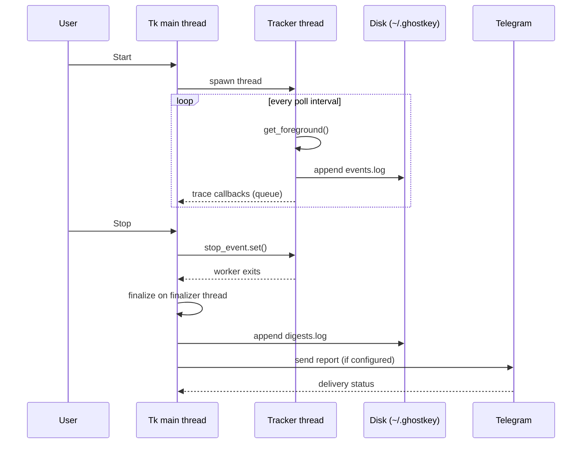

# Architecture

Ghostkey is a single-file Tkinter application. The design goal is a dashboard
that stays responsive while OS sampling and network delivery happen elsewhere.

---

## Process model

```
┌──────────────────────── Tk main thread ────────────────────────┐
│  GhostkeyApp                                                   │
│   · widgets, trace pane, table, stats                          │
│   · drains ui_queue every 40 ms                                │
│   · re-renders stats every 1 s while running                   │
└───────────────▲───────────────────────────┬────────────────────┘
                │ callbacks (queue)         │ start / stop
┌───────────────┴────────────┐   ┌──────────▼───────────────────┐
│  tracker thread            │   │  ThreadPoolExecutor (2)      │
│  · polls foreground @1 Hz  │   │  · telegram delivery         │
│  · updates state under lock│   │  · test message              │
│  · writes events.log       │   │                              │
└────────────────────────────┘   └──────────────────────────────┘
```

Rules enforced by the implementation:

- Tk widgets are **only** touched on the main thread. Workers publish closures
  through `GhostkeyApp.ui_queue`, drained by `_drain_ui_queue`.
- Shared session state (`app_seconds`, `current`, counters) is guarded by
  `GhostkeyApp.lock` (an `RLock`).
- `Stop` never blocks the UI: `_finish_stop` joins the tracker on a separate
  thread, composes the report, waits for delivery (bounded by request
  timeouts), then posts the final UI update.

## Data flow



## Module map

| Region in `scan.py` | Responsibility |
|---------------------|----------------|
| Constants, `T` palette | App identity, paths, theme tokens |
| `pick_fonts`, `load_config`, `save_config` | Font fallback and JSON config |
| `fmt_secs`, `clean_text`, `dedupe_join` | Report/text helpers |
| `_get_foreground_windows` | Win32 `GetForegroundWindow` + process name |
| `_get_foreground_linux` | `xdotool` fallback for X11/XWayland |
| `send_telegram` | Bot API POST, chunked to 4000 chars |
| `RoundedPanel` | Canvas-drawn frame with optional corner ticks |
| `GhostkeyApp.__init__` / `_build_ui` | State and layout |
| `_apply_theme` | ttk style definitions |
| `_tab_*` | Trace, output, telegram, settings views |
| `start` / `stop` / `_worker_loop` | Lifecycle and sampling |
| `_compose_digest_locked` | Report text assembly |
| `_flush_locked` / `_deliver_telegram` | Persist and send |
| `on_close` | Shutdown ordering |

## Sampling semantics

- One sample per `poll` second (default 1.0).
- Foreground time accrues to the *previous* sample's process for the elapsed
  delta, so time is approximate.
- An empty sample (lock screen, desktop) closes the current app rather than
  leaving it "active" indefinitely.
- Title transitions are stored per process, capped at 500 entries per process,
  and appended to `events.log`.

## Failure handling

- OS/API errors in the worker are traced and swallowed; polling continues.
- Network errors never block the UI; failed reports are appended to
  `buffer.txt` for later inspection.
- Config read/write failures are silent to avoid crashing on read-only homes.

## Storage

Everything is append-only text or small JSON under `~/.ghostkey`. There is no
database, no encryption, and no background service. See
[DATA_LAYOUT.md](DATA_LAYOUT.md).
