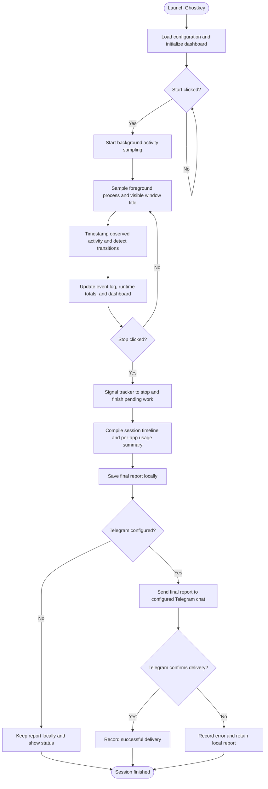

# Ghostkey --- Activity Telemetry Dashboard

Ghostkey is a Windows desktop utility that records **foreground
application names, visible window titles, application transitions, and
approximate foreground usage time** during a session. It displays the
activity in a local dashboard and can send a session summary to a
Telegram chat configured by the operator.

> **Legal and privacy notice:** Ghostkey can reveal sensitive
> information from window titles, including website names, document
> names, account identifiers, or other text displayed by an application.
> Use it only on a device and in a session you own or are explicitly
> authorized to monitor. Tell affected users what is collected, obtain
> consent where required, and follow applicable laws, workplace
> policies, and contractual obligations. This README does not make any
> deployment automatically lawful and is not legal advice.

## Features

-   Dashboard for session status, application count, event count, and
    Telegram status.
-   Foreground application/process name and visible window-title change
    tracking.
-   Timestamped application open/close transitions and approximate time
    spent in each foreground application.
-   Local event and report logs.
-   Optional Telegram delivery of the final session report.
-   Manual Telegram test and manual flush/send controls.
-   Export and copy functions for the report.
-   Settings for polling/report preferences and Telegram configuration.
-   Background tracking and asynchronous network delivery intended to
    keep the interface responsive.

## What Ghostkey collects

During a session, Ghostkey samples the active foreground window on
supported Windows systems. Depending on what is visible in that window's
title bar, records may include:

-   Timestamp of an observed event.
-   Foreground process name, such as `brave.exe`, `chrome.exe`, or
    `python.exe`.
-   Visible window title, which may identify a website, selected browser
    tab, document, or application view.
-   Application open/close transitions and estimated foreground
    duration.

### What it does not intentionally collect

Ghostkey does not intentionally record keystrokes, clipboard contents,
screenshots, microphone audio, or page/document contents. It does not
provide a complete browser history and cannot reliably identify every
page visited.

**Browser limitation:** The program samples the foreground window title
at polling intervals. Browser titles often describe only the selected
tab, and title changes that occur between samples may be missed. It does
not enumerate all browser tabs or extract search history. A search term
is recorded only if it appears in the sampled visible window title;
Ghostkey does not inspect the browser's address bar or page DOM.

## When reports are sent

-   **Stop:** Stops the tracking session and generates a final report
    from the events collected during that session. If Telegram is
    configured, Ghostkey attempts to send the report to the configured
    chat.
-   **Flush + Send:** A user-triggered action that can send a report
    before stopping, depending on the current application state.
-   **Test TG:** Sends a test message to verify the Telegram
    configuration.
-   **Export:** Saves the report to a location selected by the user.

There is no intended automatic recurring Telegram digest during a
session. Delivery depends on network access, valid Telegram credentials,
Telegram service availability, and message-size limits. Always check the
application status and local logs; do not assume a report was delivered
unless Ghostkey confirms success.

Telegram messages may be split into multiple messages to fit the
service's message-length limit. Treat Telegram as an external
third-party service: messages sent to it leave the local device and are
subject to Telegram's terms, security, retention, and account settings.

## How Ghostkey works

This flowchart shows Ghostkey's intended session workflow, from startup to final report delivery.



### Workflow explained

1. **Launch:** Ghostkey loads its saved settings and initializes the dashboard.
2. **Start:** Clicking **Start** begins foreground-application sampling.
3. **Collect:** The tracker records supported metadata such as timestamps, process names, visible window titles, and observed application transitions.
4. **Update:** The dashboard and local event log are updated with the collected events.
5. **Stop:** Clicking **Stop** signals the tracker to stop and finalize the current session.
6. **Generate:** Ghostkey compiles the collected events into a session timeline and an approximate per-application usage summary.
7. **Save:** The final report is saved locally before Telegram delivery is attempted.
8. **Send:** If Telegram is configured, Ghostkey attempts to send the final report to the configured chat. Check the application's delivery status to confirm the outcome.

### Important limitations

- This diagram describes the intended workflow; it does not prove that every step works in every code version.
- Sampling can miss brief foreground-window changes.
- A browser title is not a complete browser history. Ghostkey cannot guarantee capture of every tab, query, click, or page visited.
- Telegram delivery depends on network access, valid credentials, Telegram availability, and correct handling of message-size limits.
- The current tracking implementation relies on Windows APIs. Linux tracking requires a compatible platform-specific backend.

## Installation

### Requirements

- Python 3.10 or later is recommended.
- The `requests` package for Telegram Bot API requests.
- A desktop session. Foreground-window tracking depends on operating-system-specific APIs.

**Platform support:** The current foreground-window tracking implementation relies on Windows APIs. Windows is the supported setup path. Linux instructions are included for installing dependencies and attempting to launch the UI, but full activity tracking on Linux is **not guaranteed** until a Linux-specific active-window backend is implemented and tested for the desktop environment (such as GNOME, KDE, X11, or Wayland).

### Windows installation

1. Install Python 3.10 or later from the official Python website. Enable **Add Python to PATH** if the installer offers that option.
2. Download or clone the Ghostkey repository.
3. Open **Command Prompt** or **PowerShell** in the folder containing `ghostkey_dashboard_redesigned.py`.
4. (Recommended) Create and activate a virtual environment:

   ```powershell
   python -m venv .venv
   .\.venv\Scripts\Activate.ps1
   ```

   If PowerShell blocks activation, use Command Prompt:

   ```bat
   .venv\Scripts\activate.bat
   ```

5. Install the dependency:

   ```powershell
   python -m pip install --upgrade pip
   python -m pip install requests
   ```

6. Launch Ghostkey:

   ```powershell
   python ghostkey_dashboard_redesigned.py
   ```

### Linux installation

These commands install Python and the Telegram dependency on common Linux distributions. Package names may vary slightly by distribution.

**Ubuntu / Debian:**

```bash
sudo apt update
sudo apt install -y python3 python3-venv python3-pip python3-tk
```

**Fedora:**

```bash
sudo dnf install -y python3 python3-pip python3-tkinter
```

**Arch Linux:**

```bash
sudo pacman -Syu python python-pip tk
```

Then, from the repository directory:

```bash
python3 -m venv .venv
source .venv/bin/activate
python -m pip install --upgrade pip
python -m pip install requests
python3 ghostkey_dashboard_redesigned.py
```

If the UI does not open, confirm that you are running from a graphical desktop session and that Tkinter is installed. On some systems, the Python executable is named `python3` rather than `python`.

**Linux tracking limitation:** Installing these packages does not add Linux active-window tracking. If the source uses Windows-only APIs (for example, `ctypes.windll` or Windows-specific window enumeration), tracking may fail on Linux even if the UI opens. Reliable Linux support requires a platform-specific backend and testing for the user's X11/Wayland desktop. A successful launch alone does not prove that activity collection works.

### Telegram configuration

After launching Ghostkey, open the **Telegram** tab and configure the bot token and destination chat ID. Use **Test TG** to verify connectivity before relying on final-report delivery. Keep the bot token private.

If `requests` is not installed, Telegram delivery will not work. Actual behavior may vary by source version and operating system.

## Telegram configuration

1.  Create and manage a bot using Telegram's official `@BotFather`.
2.  Obtain the bot token through Telegram's supported process.
3.  Identify the destination chat ID you are authorized to send reports
    to.
4.  Open Ghostkey's **Telegram** tab and enter the bot token and chat
    ID, then save the configuration.
5.  Use **Test TG** and verify the message arrives in the intended chat.

### Protect your credentials

-   Treat the bot token like a password. Anyone who obtains it may be
    able to control the bot.
-   Do not commit tokens, chat IDs, or collected reports to a public
    repository.
-   Do not share screenshots that reveal credentials.
-   If a token is exposed, revoke it through Telegram's supported
    bot-management process and replace it.
-   Store the configuration file with appropriate access controls for
    the device's users.

## Local data and files

Ghostkey stores its working data under:

``` text
%USERPROFILE%\.ghostkey\
```

Common files include:

-   `config.json` --- application settings and Telegram configuration.
-   `events.log` --- recorded event log.
-   `digests.log` --- saved session reports.
-   `buffer.txt` --- local report/message buffer, if used by the running
    version.

The exact files and behavior may vary by code version. These files can
contain sensitive window-title data. Restrict access to the Windows
account and device, review retention needs, and delete records when they
are no longer needed and deletion is permitted by your retention
obligations.

## Privacy, consent, and lawful use

Before using Ghostkey, the operator is responsible for:

1.  **Authorization:** Monitor only your own device/session or systems
    for which you have explicit permission.
2.  **Notice and consent:** Provide clear notice to every affected
    person and obtain consent where required by law, policy, or
    contract.
3.  **Purpose limitation:** Use the collected data only for a
    legitimate, clearly defined purpose.
4.  **Data minimization:** Avoid collecting or sharing window titles
    that are unnecessary for that purpose.
5.  **Secure handling:** Protect local logs, Telegram credentials,
    exported reports, and destination chats.
6.  **Retention and deletion:** Define how long records are retained and
    securely remove them when no longer required, subject to applicable
    obligations.
7.  **Workplace and regulated environments:** Obtain required approvals
    before deploying on employee, school, client, shared, or managed
    devices.
8.  **Cross-border transfers:** Check applicable rules before
    transmitting activity data to an external service or a chat hosted
    in another jurisdiction.

Do not use Ghostkey for covert employee surveillance, stalking,
unauthorized monitoring, credential theft, harassment, or any other
unlawful or abusive purpose. Do not install or configure it on another
person's device without appropriate authorization and notice.

## Security considerations

-   Use a dedicated Telegram bot and a private, access-controlled
    destination chat.
-   Keep the operating system and Python dependencies updated.
-   Download or run code only from a source you trust; inspect changes
    before executing them.
-   Avoid storing reports in publicly synchronized folders unless that
    is intentional and approved.
-   If the device is shared, remember that local reports and
    configuration may be accessible to other users with sufficient
    permissions.
-   Do not treat Ghostkey as a security boundary, audit-grade recorder,
    or tamper-proof monitoring system.

## Accuracy and limitations

-   Foreground application time is approximate and depends on sampling
    frequency.
-   Brief window changes can be missed.
-   Window titles can be blank, generic, truncated, or contain sensitive
    text.
-   Process names and window titles do not prove what a person actually
    did inside an application.
-   The application is not a full browser-history collector and does not
    capture all tabs, clicks, typed searches, page contents, or
    downloads.
-   Telegram delivery can fail due to configuration, network, service,
    or API errors.
-   The software is provided without a guarantee that every event will
    be recorded or every report delivered.

## Troubleshooting

### Telegram message is not received

1.  Open the Telegram tab and confirm the bot token and chat ID.
2.  Use **Test TG** and inspect the error shown by the application.
3.  Confirm the bot is allowed to message the destination chat and that
    the chat ID is correct.
4.  Check internet connectivity and local trace/log files.
5.  Do not publish the token or a report containing private window
    titles when asking for help.

### Tracking appears inactive

1.  Confirm the session status in the dashboard.
2.  Check that the application is running on Windows.
3.  Bring a normal application window to the foreground and wait for the
    configured polling interval.
4.  Review the trace for errors.
5.  If the application crashes, preserve the error message/traceback and
    report it without exposing credentials or sensitive window titles.

### Report generation fails

Keep a backup of the local data directory before attempting repairs.
Include the traceback when reporting a bug, but redact Telegram tokens,
chat IDs, personal information, and sensitive window titles.

## Development and contribution

Bug reports and improvements should include: - Operating system and
Python version. - Ghostkey version or commit. - Steps to reproduce. -
Expected and actual behavior. - A sanitized traceback or log excerpt.

Do not include real bot tokens, private chat IDs, confidential browsing
titles, or another person's personal data in public issues.

## License and legal status

**No license is granted by this README.** Unless the repository includes
a separate `LICENSE` file that says otherwise, assume the code is
provided without permission to redistribute, modify, or use it beyond
rights granted by applicable law. Add a license file only after choosing
a license whose terms you understand and intend to apply.

This project is provided **"as is"**, without express or implied
warranties, to the maximum extent permitted by applicable law. The
author/contributor is not responsible for misuse, unauthorized
monitoring, data loss, failed delivery, or legal violations arising from
deployment. Nothing in this section excludes liability that cannot
legally be excluded.

The operator is solely responsible for determining whether a particular
use is lawful and for obtaining any required authorization, consent,
notices, approvals, and permissions. Laws differ by jurisdiction and
context. This section is a general risk notice, not a substitute for
advice from a qualified lawyer.

## Third-party services

Ghostkey's optional Telegram feature communicates with the Telegram Bot
API. Telegram is a separate service and is not affiliated with or
endorsed by Ghostkey. Review Telegram's current terms and privacy
documentation before transmitting activity reports.

## Disclaimer

Ghostkey is intended for transparent, authorized personal activity
telemetry and troubleshooting. It must not be used to violate privacy,
employment, education, computer-access, data-protection, or other
applicable laws. The presence of a disclaimer does not legalize an
otherwise unlawful use.
